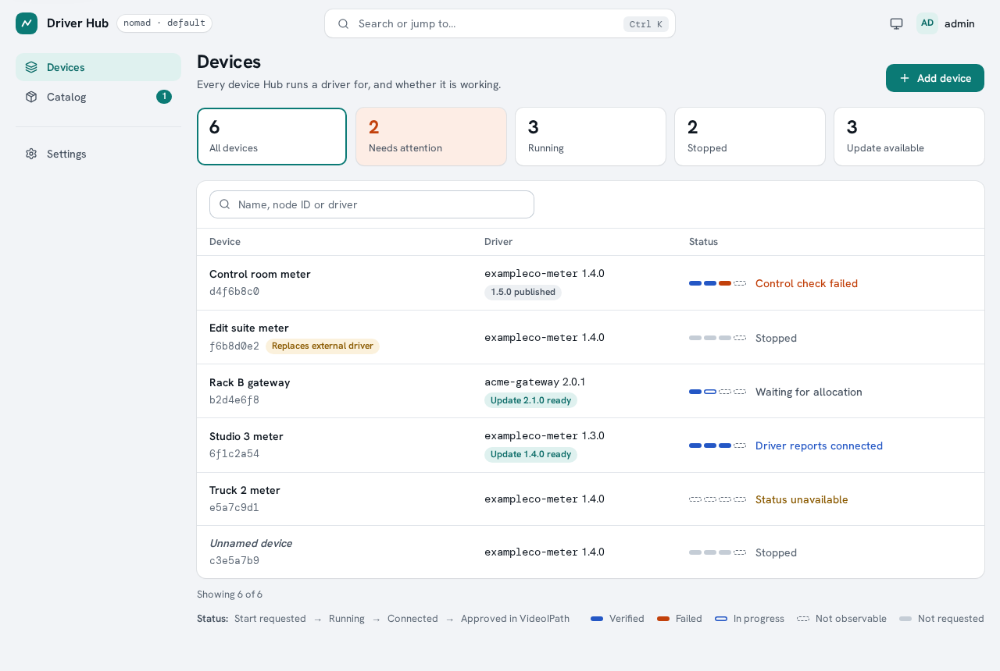
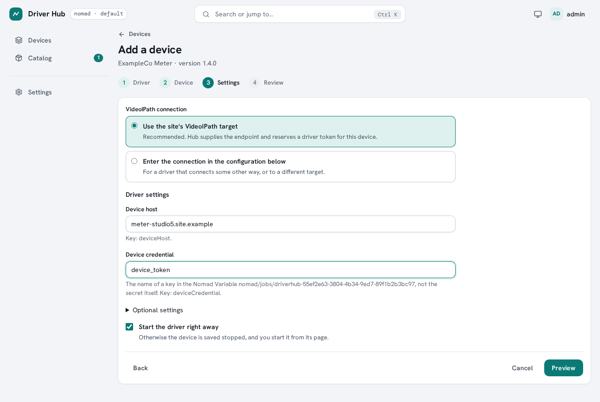
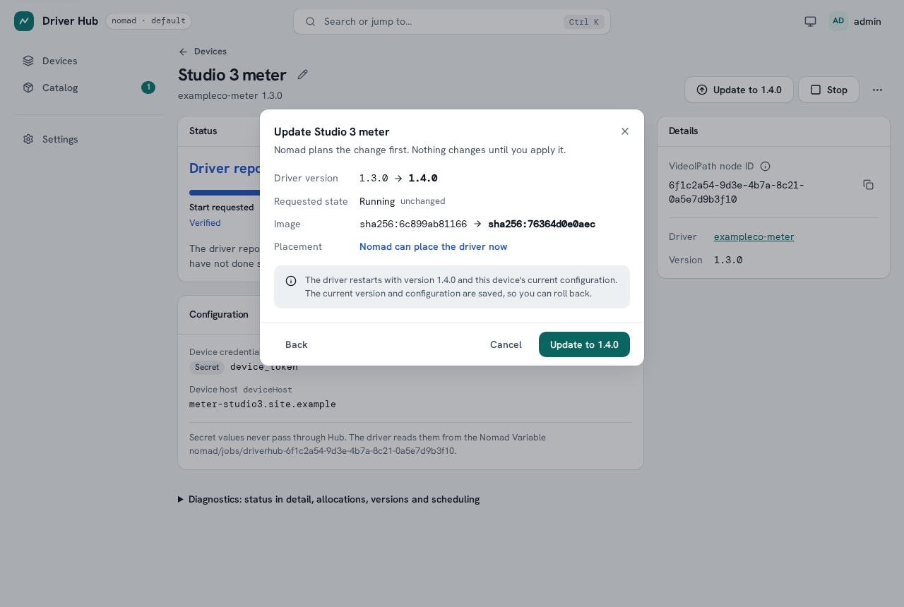
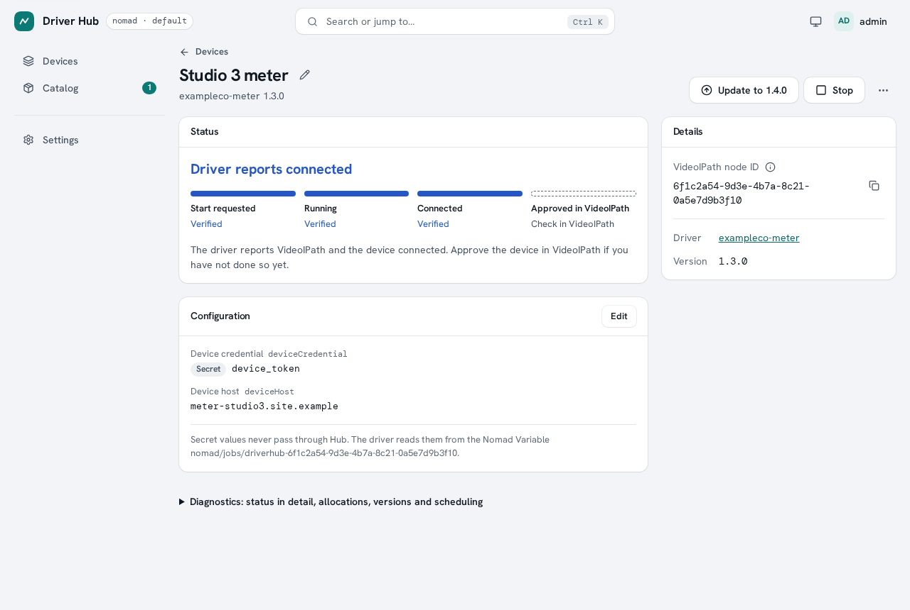
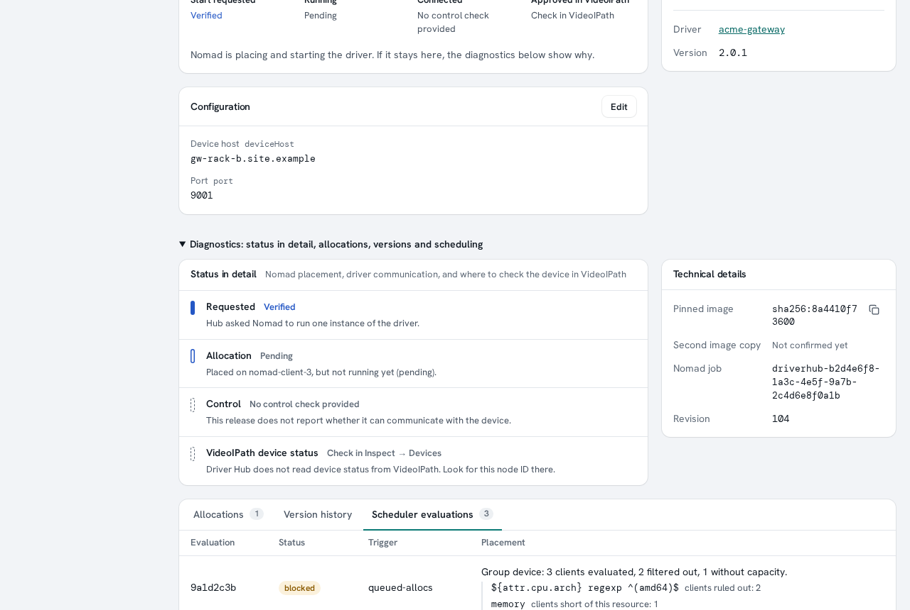
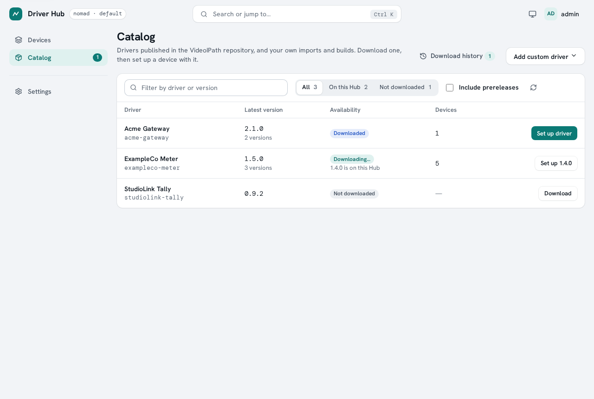
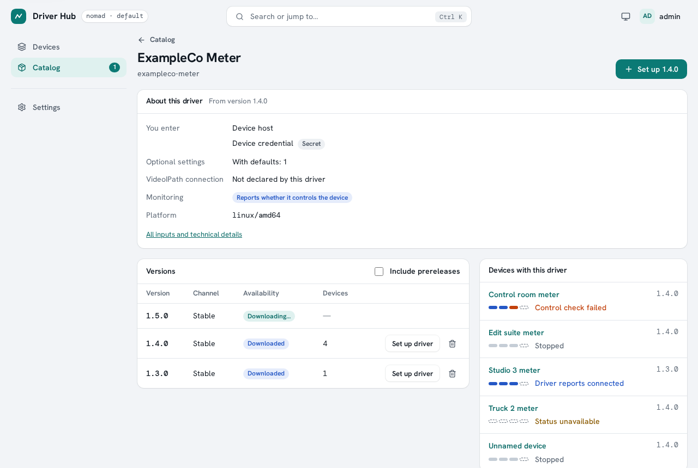
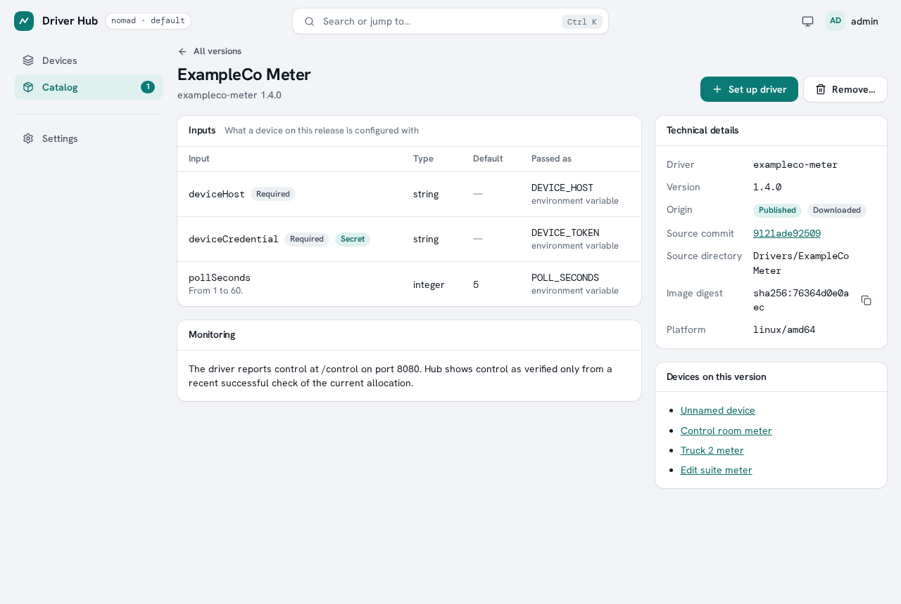
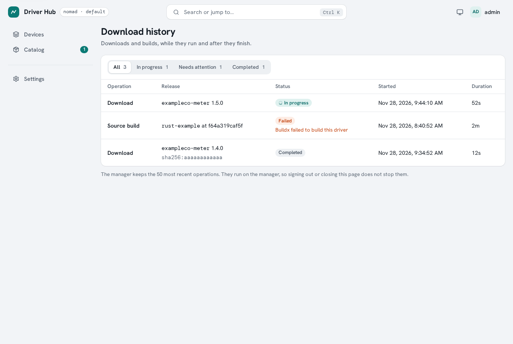
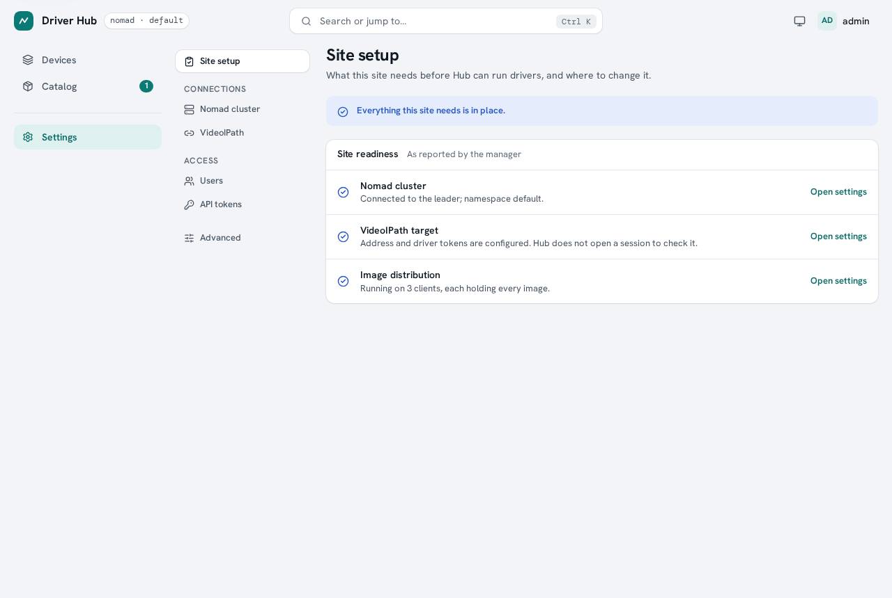

#  Driver Hub

**Deploy and monitor VideoIPath external drivers on your own Nomad cluster.** Download a release once, reuse it across devices, and see which drivers are running and which report a working connection.

**Project status: Experimental.** Driver Hub is currently intended for evaluation.

[Deploy with Docker Compose](#deploy-with-docker-compose) · [Default admin login](#default-admin-login) · [Product tour](#product-tour) · [Device status](#how-status-is-reported) · [Operations guide](OPERATIONS.md) · [Development](#development)

## Default admin login

On a fresh installation, open [http://localhost:8080](http://localhost:8080) on the Docker host and sign in with:

| Username | Default password |
| --- | --- |
| `admin` | `LicenseToDeploy!` |

**You must change the password on first login.** Enter the default password once, then choose and confirm a new password with at least 10 characters, including an uppercase letter and a digit. Hub confirms the change and keeps you signed in. Restarting or upgrading an existing installation does not reset its password.

## Deploy with Docker Compose

The standard installation is **Docker Compose**. The release image includes the manager, web app, Nomad image-service package, Docker CLI and Buildx. Compose starts a dedicated rootless BuildKit worker alongside the manager. **Driver source builds are off by default**; an administrator can turn them on under **Settings → Advanced**, without rebuilding Hub or exposing the host Docker socket.

1. Download **`compose.yaml`** into an installation directory. Either copy works without a `.env`:
   - **Always the latest release:** the [`compose.yaml` on `main`](https://raw.githubusercontent.com/magnusoverli/driver-hub/main/compose.yaml) starts `ghcr.io/magnusoverli/driver-hub:latest`. `docker compose pull` then upgrades to each new release.
   - **One fixed release:** the `compose.yaml` in a [release's](https://github.com/magnusoverli/driver-hub/releases) **Assets** stays on that release's image, pinned by digest.

   ```sh
   curl -fsSLO https://raw.githubusercontent.com/magnusoverli/driver-hub/main/compose.yaml
   ```

   Without a published image, use the [local image build](#build-the-manager-image-locally) instead.
2. Optionally, create `.env` beside `compose.yaml`, with only the lines you need:

```dotenv
# By default the web interface is published on every interface and accepts sign-in over plain
# HTTP. Behind an HTTPS reverse proxy on this machine, keep it local and the cookie Secure:
# DRIVER_HUB_LISTEN_ADDRESS=127.0.0.1
# DRIVER_HUB_ALLOW_PLAIN_HTTP=false
# Override automatic address selection only if clients need a different download address:
# DRIVER_HUB_DISTRIBUTION_ADDRESS=hub.site.example
# Stay on one release instead of the latest.
# DRIVER_HUB_IMAGE=ghcr.io/magnusoverli/driver-hub:vX.Y.Z
```

3. For a private image, [sign Docker in to GHCR](OPERATIONS.md#registry-access) with an account that can read the package. Alternatively, [load the manager image from the release assets](OPERATIONS.md#installing-the-manager-from-a-release-asset). For the registry install, run:

```sh
docker compose pull
docker compose up -d
```

4. Once Hub is running, sign in with the [default admin login](#default-admin-login) to finish setup. Hub opens **Settings → Site setup**, which lists the steps from connecting Nomad to the first device.

Under **Settings → Nomad cluster**, enter the Nomad API address (your cluster VIP) and ACL token, then **Check and save**. Allocation log links use this same address. If your browser reaches Nomad through a different URL, set the web interface override under **Settings → Advanced → Nomad jobs**.

On the same page, leave **Hub download address** under **Image distribution** blank for automatic setup. Hub registers `driverhub-images`, a Nomad system job that caches and serves driver images on each eligible client. Check **Image distribution** for the selected Hub address and healthy clients. Clients need TCP `5481` to the manager and TCP `5480` to each other.

By default Hub is reachable at `http://<host>:8080` and accepts sign-in over plain HTTP on a trusted network. For anything else, put an HTTPS reverse proxy in front (see [remote access](OPERATIONS.md#installation)). Using remote HTTP for Nomad credentials is a separate [trusted-network opt-in](OPERATIONS.md#site-setup-after-container-startup).

To [upgrade](OPERATIONS.md#upgrading-a-compose-installation), repeat the pull and start commands with the same volume. With the `compose.yaml` from `main` that moves to the latest release; with a release's own copy, download the new release's `compose.yaml` first. `docker compose down` stops Hub and keeps its data. Adding `-v` deletes accounts, settings, releases and images in the local volume; it does not remove Nomad jobs.

## Product tour

Driver Hub follows one path: **find a driver, download it, set up a device, and see whether it works.** The side navigation has three entries: **Devices**, **Catalog** and **Settings**.



*Screenshots use the six demo devices from `npm run demo`, with illustrative upstream releases, downloads and image-distribution status.*

| Page | What it is for |
| --- | --- |
| **Devices** | The home page. Every device with its status at a glance. **Needs attention**, **Running**, **Stopped** and **Update available** count the devices and filter the list. **Add device** sets up another one. |
| **Device page** | One device: its status from Hub's request to VideoIPath, what to do next, the node ID to look for in VideoIPath, and its configuration, which **Edit** changes without changing the version. **Start**, **Stop** and **Update to** a newer downloaded version are in the header. A device that has not run yet lists what to do **Before you start**, such as creating secrets or stopping the external driver it replaces. Allocations, version history and scheduler evaluations are under **Diagnostics**. |
| **Catalog** | One entry per driver, with its latest version, whether it is on this Hub and how many devices use it. **Download**, then **Set up driver**. A driver's page says what it needs, how it connects and whether Hub can monitor it, and lists every version. Imports and source builds are under **Add custom driver**; **Download history** follows downloads and builds. |
| **Settings** | **Site setup** walks a new site from connecting Nomad to its first device and reports what still needs attention. **Connections** holds the Nomad cluster with image distribution, and the VideoIPath target with its driver tokens. **Access** holds users and API tokens. **Advanced** holds source builds, request timings, Nomad job options and the manager's startup settings. |

**From catalog to running driver:** In the **Catalog**, select **Download** for the driver. When it shows **Downloaded**, select **Set up driver**, or choose **Add device** on **Devices**. Setting up takes four steps: the driver and version, the device's name and whether it replaces an existing driver, its VideoIPath connection and settings, then a review that Nomad plans before anything changes. **Deploy driver** creates the device and starts it. When the device needs secrets in Nomad or replaces an external driver, or you turned off **Start the driver right away**, **Set up device** saves it stopped, and its page lists what to do before you choose **Start**. The device page shows what Nomad and the driver report. Approve the device in VideoIPath under Inspect → Devices.



**Review before applying.** Hub asks Nomad to plan a start, stop, update, configuration change or rollback. The preview shows the version, requested state, pinned image and placement. Hub applies the revision you reviewed; if another operator has changed it, you get a conflict instead of overwriting their work. Viewers can inspect these plans; administrators apply them.



<details>
<summary><strong>See more of the interface</strong> — device status, catalog, diagnostics and settings</summary>

| A device | Investigate placement |
| --- | --- |
|  |  |

| Find a driver | Know what it needs |
| --- | --- |
|  |  |

| Inspect a release | Follow downloads and builds |
| --- | --- |
|  |  |

| Check the site | Connect VideoIPath |
| --- | --- |
|  |  |

Also pictured: [a failing device in dark mode](docs/screenshots/device-dark.png) · [Devices on a narrow screen](docs/screenshots/mobile.png). Use <kbd>Ctrl</kbd> + <kbd>K</kbd> to jump to a page, release or device.

</details>

## How status is reported

**“Running” and “connected” answer different questions.** If a device stops responding, read its status from the request through to the control check:

| Step | What Hub can verify |
| --- | --- |
| **Start requested** | Hub asked Nomad to run one instance. |
| **Running** | Nomad reports the driver running on a client. Scheduler evaluations under **Diagnostics** explain when it cannot place one. |
| **Connected** | A recent successful control check on the current allocation reports communication with VideoIPath and the device. Without a declared check, this is not observable. |
| **Approved in VideoIPath** | Approval happens in VideoIPath. Hub never marks it as verified; the device page shows the node ID to look for. |

**Image availability** is a separate site-level check. Setting up a device publishes the verified OCI image. Each eligible client runs an image service, and its drivers pull from `127.0.0.1:5480`. With the manager offline, an existing service can serve its own copy or fetch from a peer that has the image. See [image distribution and readiness](OPERATIONS.md#image-distribution) for package upgrades, port requirements and troubleshooting.

## Installation and operations

| I want to… | Start here |
| --- | --- |
| Install Hub and connect a site | [Installation](OPERATIONS.md#installation) · [Nomad and VideoIPath setup](OPERATIONS.md#site-setup-after-container-startup) |
| Give an operator or script access | [Operator sign-in](OPERATIONS.md#operator-sign-in) · [API tokens](OPERATIONS.md#api-tokens) |
| Bring my own driver | [Import a local image](OPERATIONS.md#import-a-local-image) · [Build from source](OPERATIONS.md#customer-builds) |
| Replace an existing driver or automate changes | [Deploy and migrate](OPERATIONS.md#deploy-and-migrate) · [Client API contract](OPERATIONS.md#client-api-contract) |
| Qualify a site for failover | [Monitoring and failover](OPERATIONS.md#monitoring-and-failover) · [Site acceptance](OPERATIONS.md#verification) |

## Development

### Build the manager image locally

Before the first published release, or when testing a checkout, build the same runtime target yourself. In the installation `.env` described above, set `DRIVER_HUB_IMAGE=driver-hub:local`, then run from the repository root:

```sh
docker build --target runtime -t driver-hub:local .
docker compose pull buildkit
docker compose up -d --pull never
```

Maintainers: [publish a versioned manager image](OPERATIONS.md#publishing-a-manager-release). This is separate from building or publishing a device driver.

### Try it locally

To explore six seeded devices without a cluster, use **Node.js 22.17+ and npm 11+** in a checkout:

```sh
npm ci
npm --prefix web ci
npm --prefix web run demo
```

Open **[localhost:4182](http://localhost:4182)** and sign in with the details printed in the terminal. Under **Devices → Studio 3 meter**, choose **Update to 1.4.0** to preview a version change against the stand-in Nomad cluster.

The Node.js manager serves the SvelteKit web app and `/api/v1` on the same origin. The running manager exposes its OpenAPI 3.1 contract at `/api/v1/openapi.json`. The [frontend guide](web/README.md) covers the dev server, generated types and browser tests.

| From the repository root | Purpose |
| --- | --- |
| `npm test` | Run backend API, integrity, distribution and lifecycle tests. [Docker and Nomad tests](OPERATIONS.md#verification) are opt-in. |
| `npm run web:build` | Build the frontend into `web/build` for the manager to serve. Install web dependencies first with `npm --prefix web ci`. |
| `npm run web:verify` | Check the API contract, formatting, lint, types, unit and component tests, and end-to-end behavior. |

<details>
<summary><strong>Running the backend from source</strong></summary>

With Node.js 22+, run `npm ci` and `npm start`. The same first-login credentials apply; to provision a private password instead, see [operator sign-in](OPERATIONS.md#operator-sign-in). The API defaults to `127.0.0.1:8080`; `PORT` changes the port and `DRIVER_HUB_DATA_DIR` changes the data directory (default `~/.driver-hub`). A source checkout does not include the packaged image service; use the Hub container to exercise real image distribution.

For a release's path through the backend, start with [`src/catalog.js`](src/catalog.js) and [`src/images.js`](src/images.js). For a device change, follow [`src/deployments.js`](src/deployments.js) through the [job definition](src/job.js) to the [Nomad client](src/nomad.js).

</details>

## Project status

The manager and web app support release acquisition, verified image distribution, per-device lifecycle operations and site administration. This project is independent of the [public VideoIPath external driver repository](https://github.com/VideoIPath/VideoIPath_External_Drivers). The proposed upstream packaging convention has not been adopted.

**Verified in development:** A three-client Nomad trial rolled out smaller replacement image-service packages, verified the probe manifest on every client, and rescheduled a synthetic driver with the manager stopped. Its HTTP check passed.

**Still to qualify on site:** With the management host unavailable, fail the active driver host and verify that a cold replacement pulls the pinned image, keeps its configuration and `node_id`, and restores actual device communication. Separately test a network partition: under the [external driver protocol](https://github.com/VideoIPath/VideoIPath_External_Drivers/blob/main/examples/rust_example/docs/PROTOCOL.md), two processes with the same node ID can displace each other. A desired count of one does not prove safe takeover. No recovery-time target has been agreed.

<details>
<summary><strong>Application definitions</strong></summary>

| Term | Meaning |
| --- | --- |
| Driver | Software that connects VideoIPath to a device. Its catalog identity identifies the software, not a particular device. |
| Release | A maintainer-published version of one driver. Its OCI digest identifies the exact image. |
| Customer build | A locally deployable image with its own source revision and digest, even when built from the same tag as a maintainer release. |
| Deployment | The persistent association between a device, its stable VideoIPath `node_id`, its configuration and the selected image. |
| Running instance | The process Nomad runs for a deployment. A replacement uses the same deployment identity. |
| Recovery | Communication between VideoIPath and the device has returned. A running container alone does not establish recovery. |

</details>

<details>
<summary><strong>Decision record and upstream proposal</strong> — interview items 1–15</summary>

| Interview item | Decision and consequence |
| --- | --- |
| 1. Deployment unit | Download a release once and reuse it across devices. Each device gets its own configured instance and can be updated independently. |
| 2. Availability | Recover control automatically after process or host failure. Driver loss interrupts control and can leave monitoring or alarms stale. Media still processed by the device under its last configuration is outside the driver recovery path. |
| 3. Nomad boundary | The customer operates Nomad and supplies a stable API address. Hub submits and observes jobs; Nomad schedules and recovers workloads without Hub being online for each restart. |
| 4. Ownership | [Driver Hub](https://github.com/magnusoverli/driver-hub) is a private, independent project, not an official upstream component or fork. |
| 5–7. Distribution | Prefer versioned maintainer images. Administrators may also build pinned source and run those builds in production; nothing is published upstream. |
| 8–10. Connectivity and distribution (revised) | Hub needs internet access for upstream discovery and download. The earlier disconnected-installation requirement is superseded. Hub distributes images to eligible clients without integrating a customer registry. |
| 11. Release discovery | Discover updates per driver, independently of unrelated repository changes. Propose a machine-readable convention to upstream maintainers. |
| 12. Approval | Approval stays in VideoIPath. Report Nomad process state separately from driver communication. |
| 13. Migration | Keep the existing `node_id`. Stage the replacement, stop the original, start the replacement, then verify control. To revert, stop the replacement before restarting the original. |
| 14. Configuration | Releases declare input types, requirements, defaults, secret fields and delivery bindings. Customer values stay local and are validated against the target release before cutover. |
| 15. Image distribution | Hub manages a service on each eligible client. Drivers pull locally; no separate registry or per-driver image host is required. Hub selects the manager download address automatically, with an optional override. |

**Upstream convention (items 11 and 14).** The VideoIPath External Drivers repository has adopted the per-driver release convention: `Drivers/RELEASING.md`, JSON Schemas for `driver-release.json` and `driver-config.json` under `Drivers/schemas/`, and `drivers/rust-example/v0.3.0` as the first release. Hub accepts every input property those schemas define. The work order in [docs/workorders/external-drivers-driverhub-compatibility.md](docs/workorders/external-drivers-driverhub-compatibility.md) states Hub's full driver contract and the remaining upstream work: schema support for `controlHealth`, `nodeIdInput` and `videoIPathInputs`, a control-health endpoint and a shorter shutdown in the Rust example, and validation for every driver. The release pilot still needs two versions of one driver, a changed required setting, and an update and rollback.

Preserve the interview numbers when revising a decision; add subsequent decisions with the next available number.

</details>
