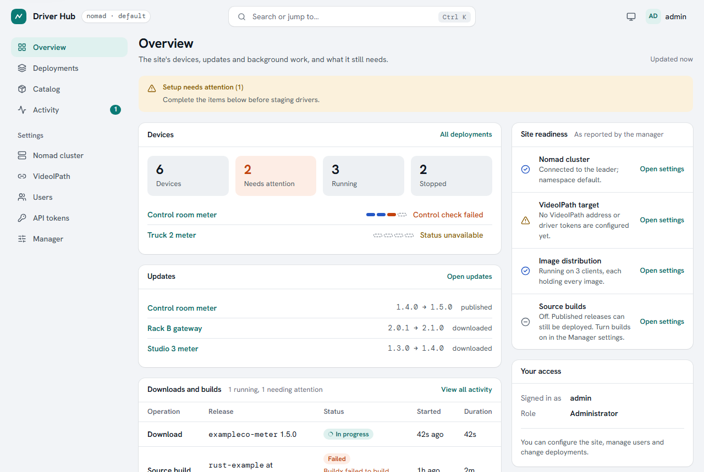
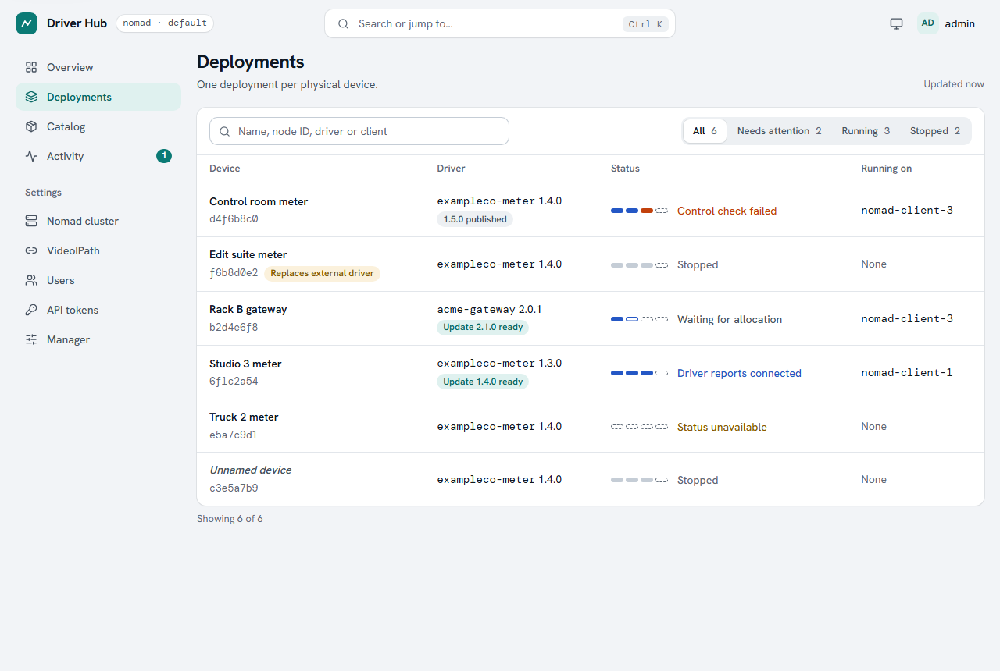
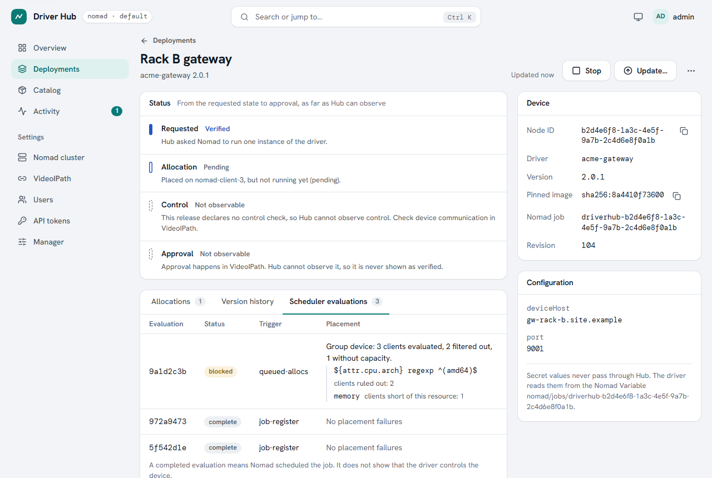
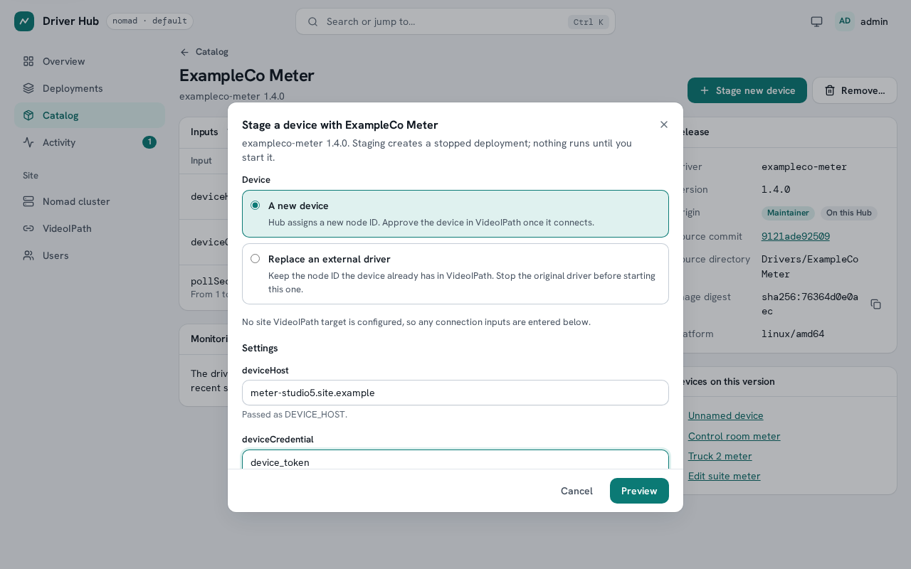
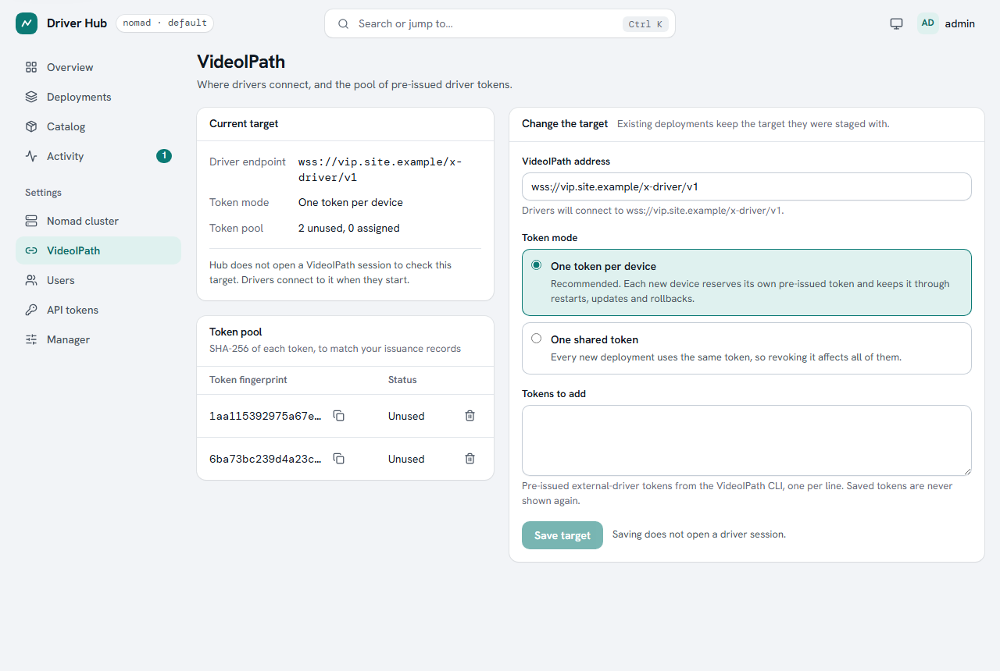
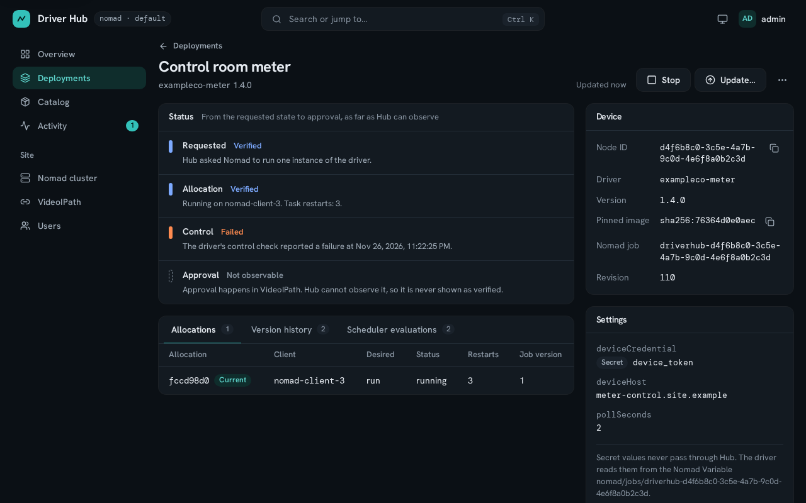
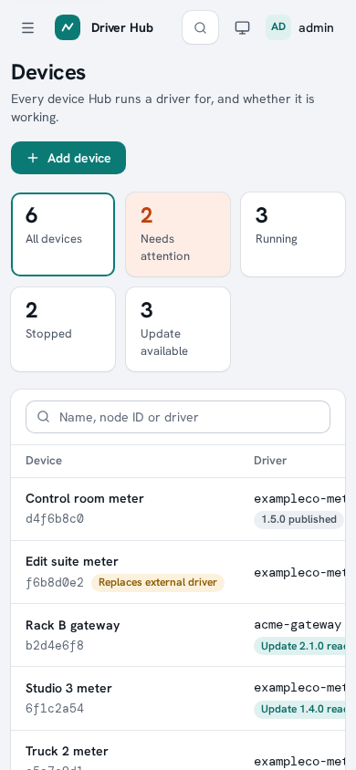

# Driver Hub

Driver Hub is a self-hosted web application for customer operators and administrators to browse, download, deploy, monitor and update VideoIPath external drivers. It takes releases from the [public driver repository](https://github.com/VideoIPath/VideoIPath_External_Drivers), runs one driver instance per physical device on a customer-operated Nomad cluster, and reports only what it can verify about each device. This project is independent of the upstream repository.

**Project state:** The manager and its web app cover the first-release scope. That scope is:

- release discovery, download, local import and source builds;
- verified OCI image distribution;
- per-device staging, migration, start, stop, update, rollback and deletion through Nomad;
- site setup and local operator accounts.

Site commissioning against VideoIPath and a physical device is still required, and the upstream release convention remains a proposal. See [installation and operation](OPERATIONS.md) for the API, permissions and the HA acceptance procedure.

## What it does

### Deployments: one per physical device

- **Device list.** Every device appears with its four-step status and a plain-language condition, such as _Driver reports connected_, _Control check failed_ or _Waiting for allocation_. Filter by _Needs attention_, _Running_ or _Stopped_, and search by name, node ID, driver or Nomad client.
- **Device page.** Each status step is explained in a sentence. The page shows the device's allocations, its Nomad version history, and the scheduler evaluations, including why Nomad could not place a driver.
- **Preview before apply.** Start, stop, update (optionally with changed settings) and roll back are each planned by Nomad as a dry run first. The change is applied at the revision you reviewed, so a concurrent change is reported rather than overwritten. If Hub gets no definite answer, it says the change may have been applied and asks you to check before retrying.
- **Migration.** Replace an external driver under its existing node ID. The first start asks you to confirm that the original driver is stopped.
- **Names and deletion.** Name devices (renaming never restarts a driver), and delete stopped deployments after typing the device's name.

| Deployments | Device page |
| --- | --- |
|  |  |

### Catalog

- **Releases.** See releases published upstream, releases on this Hub (downloaded, imported or built), and newer versions for deployed devices.
- **Release page.** Each release has a page with its inputs, how the driver receives each one, its control check, image digest and platforms, and the devices on that version.
- **Getting releases (administrators).** Download releases in the background, import a prebuilt OCI image archive, or build a pinned source revision on a build-enabled manager. Releases no device needs can be removed.
- **Staging.** Stage a new device, or a replacement, from the inputs the release declares. Secrets are entered as references to keys in a Nomad Variable; Hub never handles secret values. With a site VideoIPath target, Hub supplies the endpoint and reserves a driver token for the device.

| Catalog | Release |
| --- | --- |
|  |  |

### Activity

Downloads and builds run on the manager in the background. Activity lists them with their outcome, duration and failure reason, and flags operations a manager restart interrupted. While work runs, a count appears beside _Activity_ in the navigation.

### Settings

Administrators set up the site under **Settings**. Everything that can be changed while Hub runs is changed there; `compose.yaml` keeps only what the manager needs to start.

- **Nomad.** The connection (address, namespace, datacenters and ACL token; Hub saves only after it reaches the leader and can list jobs), and how jobs run: the image host Nomad clients pull from, the link to the Nomad web interface, and whether other processes also edit Hub's jobs.
- **VideoIPath.** The driver endpoint and the pool of pre-issued driver tokens, one per device or shared. Tokens show as SHA-256 fingerprints to match your issuance records. Unused tokens, and tokens of deleted devices, can be removed.
- **Users.** Local accounts with an _Administrator_ or _Viewer_ role. Accounts can be disabled, given a new password or deleted; the last administrator is protected.
- **API tokens.** Named bearer tokens for scripts, each an _Administrator_ or _Viewer_, shown once and revocable.
- **Manager.** Source builds and request timings, plus a read-only list of the startup settings from the manager's environment, with where each comes from.

A device's own values, entered at staging, are its **Configuration**, shown on its page.

### Throughout

- **Roles.** Viewers see everything and can preview changes; administrators apply them. The API enforces the same rules.
- **Command palette.** <kbd>Ctrl</kbd> <kbd>K</kbd> jumps to pages, devices and releases.
- **Themes, layout and accessibility.** Light and dark themes and narrow screens are supported, and every page is checked against WCAG 2.2 AA in the automated tests.

| Dark theme | Narrow screen |
| --- | --- |
|  |  |

## How status is reported

Each device shows four steps between "Hub asked for it" and "the device is in service":

| Step | Verified when |
| --- | --- |
| Requested | Hub asked Nomad to run one instance. |
| Allocation | Nomad runs the driver on a client. |
| Control | A recent control check of the current allocation reports that the driver reaches VideoIPath and the device. Only drivers that declare a control check can show this; a running container alone never counts. |
| Approval | Never. Approval happens in VideoIPath, which Hub cannot observe. |

A step Hub has no evidence for is shown as _not observable_, never as success. Accepting a change only means Nomad has the new desired state; the status shows when the driver actually runs.

## Try it locally

With Docker, start the manager and web app on `http://localhost:8080`:

1. Next to `compose.yaml`, create a file named `.env` containing `DRIVER_HUB_INITIAL_PASSWORD=` followed by a password of at least 12 characters. It is only used to create the first account, `admin`, while the data volume is empty. The file is ignored by Git.
2. Run `docker compose up --build -d`, then open `http://localhost:8080` and sign in as `admin`.

Use `localhost`, not an IP address: the session cookie is `Secure`, which browsers accept over plain HTTP only on `localhost`. Without a Nomad cluster, the overview reports what the site still needs. `docker compose down` stops it; add `-v` to also delete the accounts and settings. `compose.yaml` lists the startup settings with their defaults; everything else is set in the web app under Settings.

**Explore the deployment screens without a cluster:** with Node.js 22.17+ and npm 11+, run `npm ci` in this directory and in `web/`, then `npm run demo` in `web/`. This starts the manager with a stand-in Nomad cluster and six example devices on `http://localhost:4182`, and prints the sign-in details. The screenshots above were taken from it.

## Running the backend

For a container installation, follow [site setup after startup](OPERATIONS.md#site-setup-after-container-startup). Administrators then configure the Nomad connection, the image host and the VideoIPath target under Settings in the web app, or through the site API. By default each logical device receives its own pre-issued VideoIPath token and keeps it across allocation replacements.

Install Node.js 22 or newer and run `npm ci`. For a new installation, set `DRIVER_HUB_BOOTSTRAP_PASSWORD_FILE` to a protected file containing the first administrator's password, then run `npm start`. See [operator sign-in](OPERATIONS.md#operator-sign-in) for the login API, account management and API tokens. The manager listens on `127.0.0.1:8080`; set `PORT` to change the port. It serves the built web app from `web/build` (`npm run web:build`) on the same origin as the API.

| Area | Endpoints under `/api/v1` |
| --- | --- |
| Releases | `GET /releases`, `GET /releases/{driverId}/{version}`, `GET /retained`, `GET`/`PUT`/`DELETE /retained/{driverId}/{version}`, `PUT /imports/{driverId}/{version}`, `POST /builds`, `GET /updates`, `POST …/deploy-form` |
| Deployments | `GET`/`POST /deployments`, `GET`/`DELETE /deployments/{nodeId}`, `POST /deployments/{nodeId}/{start,stop,update,rollback}` (with `?dryRun=true` to plan), `PUT …/label`, `GET …/history`, `GET …/evaluations` |
| Background work | `GET /operations`, `GET /operations/{id}` |
| Site | `GET /site`, `PUT /site/{nomad,deployment,manager,videoipath}`, `DELETE /site/videoipath/tokens/{fingerprint}`, `GET /site/environment`, `GET /integrations/nomad`, `GET /capabilities` |
| Accounts | `POST /auth/login`, `GET /auth/session`, `POST /auth/logout`, `POST /auth/password`, `GET`/`POST /users`, `PATCH`/`DELETE /users/{username}`, `GET`/`POST /api-tokens`, `DELETE /api-tokens/{id}` |

The [client API contract](OPERATIONS.md#client-api-contract) describes requests, errors and revisions in detail; the running manager also serves it as OpenAPI 3.1 at `/api/v1/openapi.json`, from which the web app's types are generated.

Set `DRIVER_HUB_DATA_DIR` to select the data directory (default: `.driver-hub` in the user's home). Retention verifies the archive checksum and commits a version by directory rename. Before job submission, `src/images.js` validates the OCI layout, manifest/index digest, referenced descriptors, blob sizes, checksums and declared platforms. The separate pull-only distribution process serves verified content from `DRIVER_HUB_IMAGES_DIR` and needs neither the manager nor GitHub.

`src/catalog.js` coordinates discovery and retention, `src/imports.js` verifies uploaded images, `src/builds.js` produces site-local releases, and `src/retention.js` removes unused ones. `src/deployments.js` orchestrates lifecycle operations; `src/job.js` translates a validated deployment to a job, and `src/nomad.js` implements the cluster API. Job definitions and revision checks live in Nomad, so recovery does not depend on a running management API.

## Development

| Command | Purpose |
| --- | --- |
| `npm test` | Backend API, integrity, retention and lifecycle tests. Opt-in real Docker and Nomad tests are described in [OPERATIONS.md](OPERATIONS.md#verification). |
| `npm run web:verify` | The web app's contract check, formatting, linting, type checking, unit and component tests, and end-to-end tests against a real manager. |
| `npm --prefix web run demo` | The demo installation described above. |

The web app is a SvelteKit single-page application; [`web/README.md`](web/README.md) describes its structure, design system and test setup.

## Application definitions

| Term | Meaning in Driver Hub |
| --- | --- |
| Driver | Software that connects VideoIPath to a device through the external driver API. Its catalog identity identifies the software, not a particular device. |
| Release | A maintainer-published version of one driver, distributed as a ready-to-run OCI image. A version is meaningful within that driver; the image digest identifies the exact content to run. |
| Customer build | A deployable image built from source for one customer's use. Keep its source revision and image digest distinct from maintainer releases, even when built from the same tag. |
| Deployment | The persistent association between a physical device, its stable VideoIPath `node_id`, its customer configuration and the selected driver image. It survives process replacement. |
| Running instance | The process Nomad runs for a deployment. One active instance per device is the goal; a replacement uses the existing deployment identity. |
| Recovery | Communication between VideoIPath and the device through its driver has returned. A running container alone does not establish recovery. |

## Decision record

| Interview item | Decision and consequence |
| --- | --- |
| 1. Deployment unit | Download a release once and reuse it across devices. Each physical device gets an independently configured instance; updating one need not interrupt the others. |
| 2. Availability | Recover control automatically after a process or host failure. Driver loss interrupts device control and may leave monitoring or alarms stale. Media that the device continues processing with its last configuration is outside the driver recovery path. No recovery-time target has been agreed. |
| 3. Nomad boundary | Customer operates the cluster and provides a stable API address. Driver Hub submits and updates jobs and observes their status. Nomad schedules and recovers workloads without requiring Driver Hub to be online for each restart. |
| 4. Ownership | The project repository is private: [magnusoverli/driver-hub](https://github.com/magnusoverli/driver-hub). It is not a fork or an official component of the upstream project. |
| 5–7. Distribution | Prefer versioned, maintainer-published OCI images. Also support downloading source and building in a connected Driver Hub environment. Customer admins may test or run their own builds, including in production; these actions never publish upstream. |
| 8–10. Connectivity and distribution (revised) | Assume the running Driver Hub has internet access for release discovery and download. The earlier requirement to support a disconnected installation is superseded. Driver Hub owns image distribution to eligible Nomad clients; no integration with customer-private registries. |
| 11. Release discovery | Discover updates per driver, independently of unrelated changes in the public repository. Propose a machine-readable per-driver release convention to upstream maintainers. Its adoption is pending. |
| 12. Approval | Device approval stays in VideoIPath. Distinguish Nomad process status from driver communication; report only states that can be verified. |
| 13. Migration | Support moving an already-running external driver to Driver Hub in the first release. Preserve the existing `node_id`. Stage the replacement, stop the original, start the replacement, then verify control. To revert, stop the replacement before restarting the original. |
| 14. Configuration | Each deployable release declares its inputs: names, types, requirements, defaults where applicable, secret fields and how the image receives them. Customer values stay local. Validate against the target release before deployment or cutover. |

The lifecycle and status meanings above are shared product behavior. The web frontend follows them: it shows process status and driver communication separately and never reports approval as verified.

**HA acceptance criterion:** With the Driver Hub management host unavailable, fail the host running a driver. Given a functioning Nomad cluster and an eligible replacement client with no cached image, Nomad must be able to start the pinned image with the existing configuration, credentials and `node_id`, and restore device communication. Recovery must not depend on the management host returning. The connectivity assumption applies to the running Hub; it does not require every Nomad client to have internet access.

## Upstream proposal (items 11 and 14)

The maintainer-facing draft is deliberately kept outside this repository: `VideoIPath-Driver-Release-Proposal.md` on the project owner's Desktop. It proposes a per-driver Git tag and GitHub Release with three offline-transferable assets: `driver-release.json`, `driver-config.json`, and an OCI image archive. Consumers would verify the referenced digests before deployment. Source-only contributions would remain valid. These filenames and formats are proposals, not a prerequisite the public repository already satisfies.

## Resume here

The first unresolved design question is **safe failover during a network partition**. Under the documented external driver protocol, a second connection with the same `node_id` takes over the session. If a Nomad client loses contact with its servers but its driver can still reach VideoIPath, the original and replacement could repeatedly displace each other. A desired instance count of one does not settle that case. See the upstream [protocol walkthrough](https://github.com/VideoIPath/VideoIPath_External_Drivers/blob/main/examples/rust_example/docs/PROTOCOL.md).

| Open design item | What to establish |
| --- | --- |
| Failover and health | How to prevent competing instances, what evidence confirms device communication, and how quickly control needs to return. Verify takeover and recovery with the intended VideoIPath release. |
| Image distribution | Commission the independent distribution replicas and storage; verify a pull by a cold replacement client with the management host powered off. |
| Release pilot | Whether upstream maintainers accept the convention. Exercise discovery and download of two releases of one driver, a changed required setting, update and rollback. |

When resuming work, read this file first. Preserve the interview numbers when revising a decision, distinguish proposals from agreements, and add subsequent decisions with the next available number.
